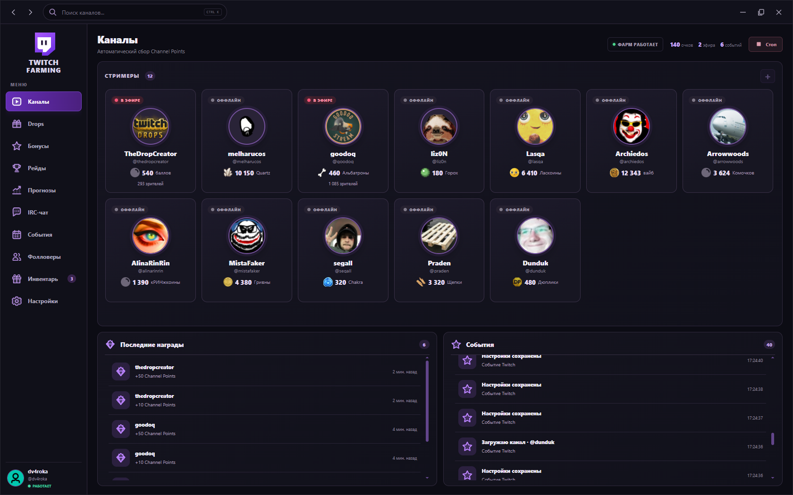
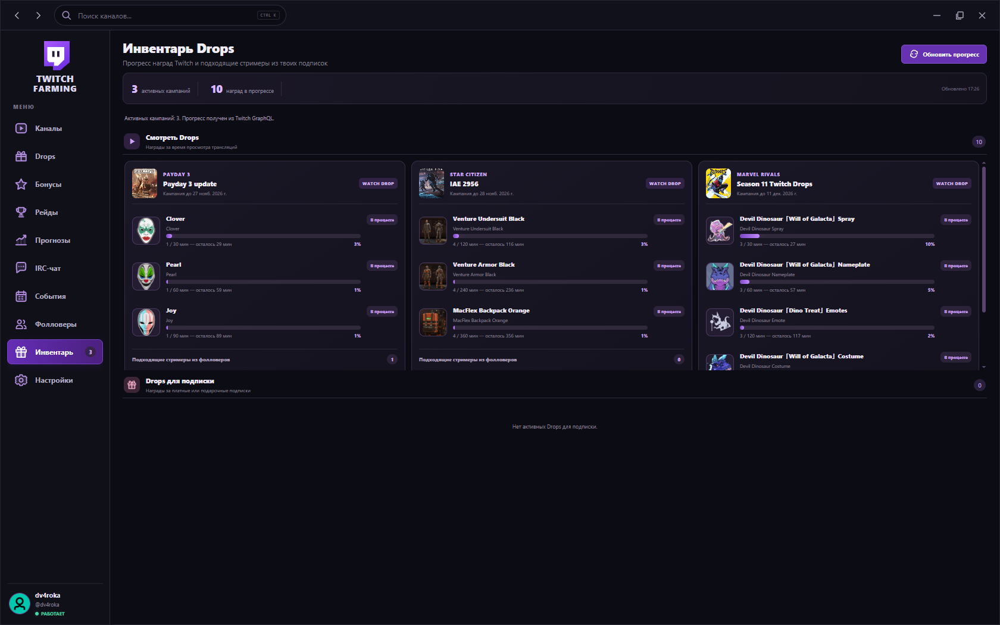
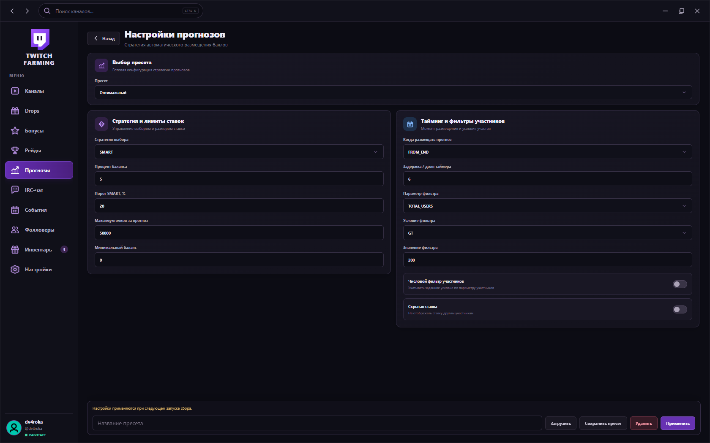
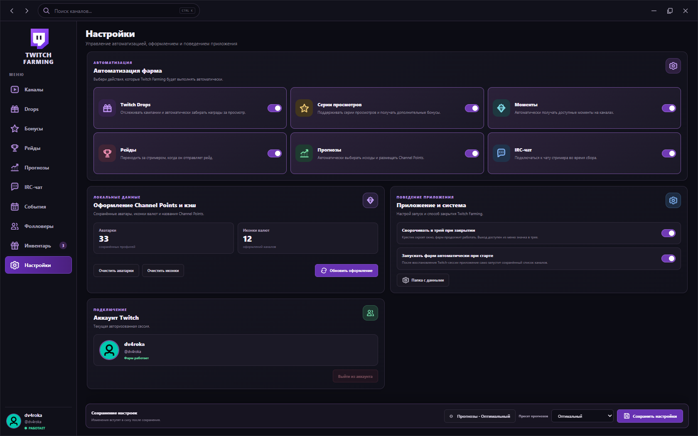

<p align="center">
  
</p>

<h1 align="center">Twitch Farming</h1>

<p align="center">Настольное приложение для автоматического сбора Channel Points, Twitch Drops и других доступных наград.</p>

<p align="center">
  <a href="https://www.python.org/"></a>
  <a href="https://pywebview.flowrl.com/"></a>
  
  <a href="https://github.com/gamooda/KICK-FARMING/releases/latest"></a>
</p>

<p align="center">
  <a href="https://github.com/gamooda/KICK-FARMING/releases/latest">Скачать</a>
  ·
  <a href="#установка">Установка</a>
  ·
  <a href="#скриншоты">Скриншоты</a>
</p>

---

## Возможности

- Автоматический сбор Channel Points на выбранных каналах.
- Пользовательские иконки и названия валют каналов.
- Отслеживание прогресса и инвентаря Twitch Drops.
- Автоматические ставки на прогнозы с настраиваемыми стратегиями.
- Обработка рейдов, бонусов, моментов и серий просмотров.
- Ручная сортировка каналов с сохранением приоритета.
- Лёгкий интерфейс на PyWebView и WebView2.
- Локальное хранение настроек и защищённой Twitch-сессии.

## Скриншоты

<table>
  <tr>
    <td width="50%" align="center">
      <strong>Каналы</strong><br><br>
      
    </td>
    <td width="50%" align="center">
      <strong>Инвентарь Drops</strong><br><br>
      
    </td>
  </tr>
  <tr>
    <td width="50%" align="center">
      <strong>Настройки прогнозов</strong><br><br>
      
    </td>
    <td width="50%" align="center">
      <strong>Настройки приложения</strong><br><br>
      
    </td>
  </tr>
</table>

## Установка

### Готовая версия

1. Откройте [последний релиз](https://github.com/gamooda/KICK-FARMING/releases/latest).
2. Скачайте `Twitch Farming.exe`.
3. Запустите файл на Windows 10 или 11.
4. При первом подключении введите логин Twitch и подтвердите авторизацию на официальной странице.

Для работы приложения требуется [Microsoft Edge WebView2 Runtime](https://developer.microsoft.com/microsoft-edge/webview2/).

### Запуск из исходников

Требуются Git, Python 3.11 и WebView2 Runtime.

```powershell
git clone https://github.com/gamooda/KICK-FARMING.git
cd "KICK-FARMING/Twitch Farming"
py -3.11 -m venv .venv
.\.venv\Scripts\python.exe -m pip install --upgrade pip
.\.venv\Scripts\python.exe -m pip install -r requirements.txt
.\.venv\Scripts\python.exe app.py
```

Пароль Twitch приложение не запрашивает. Авторизация выполняется через официальный механизм Twitch.

## Структура

- `Twitch Farming/` — Python-приложение, интерфейс и движок Twitch.
- `Twitch Farming/ui/` — HTML, CSS и JavaScript интерфейса.
- `assets/` — логотип и скриншоты README.

## Сборка

Windows EXE собирается через GitHub Actions при изменениях в `Twitch Farming/`. Готовые версии публикуются в [Releases](https://github.com/gamooda/KICK-FARMING/releases).

## Лицензия

Движок основан на [Twitch-Channel-Points-Miner-v2](https://github.com/rdavydov/Twitch-Channel-Points-Miner-v2). Лицензия GPL-3.0 и сведения об изменениях находятся в [LICENSE](Twitch%20Farming/LICENSE) и [UPSTREAM.md](Twitch%20Farming/UPSTREAM.md).
